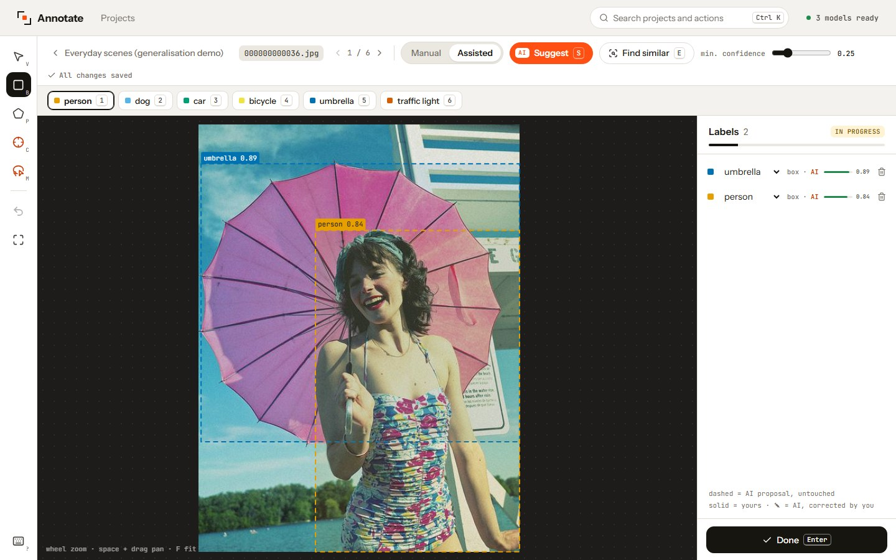
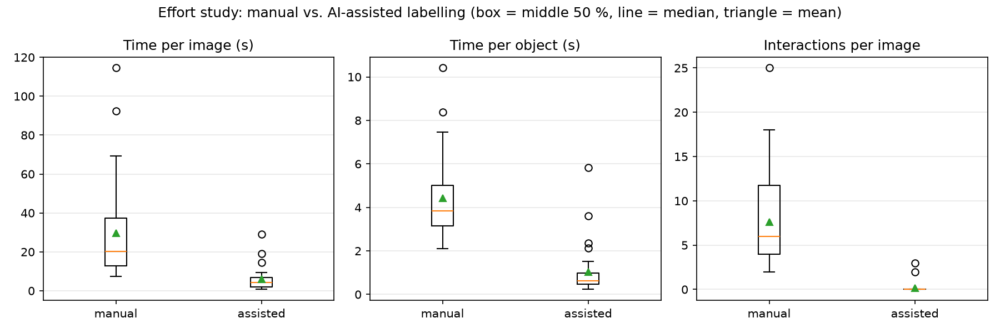

# AI-Assisted Image Annotation Platform

A general-purpose web application for labelling images for object detection: **any image
domain, your own labels per project**, and computer-vision models doing most of the work.
A **general open-vocabulary detector (YOLOE)** reads the project's label names and pre-labels
the image, **find similar** adds more objects like one example box (for labels no model knows by
name), a **smart click** turns one click into a correctly labelled box, and **MobileSAM**
outlines objects as polygons. Where a **fine-tuned specialist** exists for a project's labels, it
takes over those labels. The annotator reviews and corrects, then exports a standard **COCO** or
**YOLO** dataset.

Case study used for fine-tuning and evaluation: **construction-site helmet compliance**, every
`helmet` (head wearing a hard hat) and every `head` without one. Built as the individual project
of the *AI Vision* module, SRH Hochschule Heidelberg.



## Results at a glance

| | Result |
|---|---|
| Detector (YOLO11n, fine-tuned, 600 held-out test images) | **mAP50 0.945 · mAP50-95 0.632** |
| Same model exported to OpenVINO, on a laptop CPU | mAP50 0.943 (no accuracy lost) · **58 ms** per image |
| Smart click vs. SAM click (300 test objects, box IoU) | **0.77** vs. 0.47 mean IoU · 92 % vs. 46 % usable (IoU ≥ 0.5) |
| Effort study (60 test images, manual vs. assisted) | **−80 % time per image** (29.7 s → 5.8 s, Mann-Whitney p < 0.0001, r = 0.88) |
| Label quality vs. ground truth (F1, IoU ≥ 0.5) | manual 0.70 · assisted 0.93 · caveat: automation bias, see below |
| General model YOLOE, zero-shot on 80 classes it was never trained on (coco128) | **mAP50 0.52** · precision 0.65, recall 0.48 at the app default · 250 ms (YOLO-World v2: 0.55) |
| Helmet test split: fine-tuned specialist vs. general model (text prompts) | mAP50 **0.94 vs. 0.16**: where labelled data exist, fine-tuning is worth it |

Details: [eval/results/](eval/results/) (all numbers are reproducible, see *Evaluation*).



## Quick start

Requirements: **Docker Desktop** (or Docker Engine with Compose v2), ~6 GB free disk, internet on
the first start.

```bash
git clone https://github.com/pramod05edu-afk/AI-annotation-tool.git
cd AI-annotation-tool
docker compose up --build
```

Open **http://localhost:3000**. The first start takes a few minutes (building the images,
downloading the models); the header shows *Backend ok* and the AI buttons enable themselves when
the models are ready.

| Service | URL |
|---|---|
| Web app | http://localhost:3000 |
| API docs (Swagger) | http://localhost:3000/api/docs |
| SeaweedFS filer UI (stored images) | http://localhost:8888 |

Default local-development credentials are in [.env.example](.env.example); copy it to `.env` to
change them. The database is exposed on host port **5433** (not 5432) to avoid clashing with a
locally installed PostgreSQL.

**Models are downloaded automatically** into `weights/` (git-ignored) on the first start:
the fine-tuned detector from this repository's
[GitHub Release `model-v1`](https://github.com/pramod05edu-afk/AI-annotation-tool/releases/tag/model-v1)
(SHA-256 verified), MobileSAM, YOLOE and its MobileCLIP2 text encoder from the Ultralytics
releases (~330 MB in total, first start only).

## Features

**Dashboard and navigation**
- Live statistics (images labelled, labels, share proposed by the AI, the fine-tuned detector's
  test mAP), project cards with image preview, labels, progress and annotation mode, and filters
  (assisted / manual / in progress / done) with counts.
- Command palette (`Ctrl+K`) to jump to any project; backend status and number of loaded models
  in the header.
- Design "Studio Light": a calm, light interface where **one signal colour (orange) marks
  everything the AI did** (Suggest, AI tags, AI share), monospace for numbers and scores, and a
  dark lightbox canvas so photos keep their contrast. Fonts are bundled (no external requests);
  the class palette is colour-blind safe (Okabe-Ito).

**Projects and images**
- Projects with **their own labels** (any names, any number) for **any kind of image**;
  drag-and-drop upload (PNG / JPEG / WEBP, validated by
  content), thumbnail grid with status (*to do / in progress / done*) and progress bar.

**Annotator**
- Boxes and polygons on a zoomable, pannable canvas; select, move, resize, edit polygon points.
- Tool rail with tooltips; keyboard-first: `B` box, `P` polygon, `V` select, `1`–`9` class,
  `Del`, `Ctrl+Z` undo, `A`/`D` previous/next image, `Enter` done, `?` all shortcuts.
  Autosave after every change.
- Label panel with colour-coded confidence bars, so uncertain AI proposals stand out.

**AI assistance** (*Assisted* mode), for any labels
- **Two detectors, chosen per label:** the **general model (YOLOE)** finds whatever the project's
  label names describe, without training; for labels a **fine-tuned specialist** was trained on
  (here `helmet`, `head`), the specialist answers instead, because it is far more accurate on its
  own data. Projects can mix both; every box records which model produced it.
- ✨ **Suggest** (`S`, automatic on new images): pre-labels the image; confidence slider; AI
  boxes are dashed and keep their score and model.
- 🔎 **Find similar** (`E`): select one box as an example → the general model adds more objects
  that look like it (visual prompt). For labels without a name a model would know (a product,
  a defect, a cell type).
- 🎯 **Smart click** (`C`): click an object → the best box under the click, with its label,
  including weak candidates the automatic suggestions hid; already labelled objects are
  skipped. Detections are cached per image (repeat clicks ≈ 1 ms).
- 🪄 **Magic click** (`M`): MobileSAM outlines an object as a polygon (click = object,
  Shift / right click = not object); the image is encoded in the background when it opens.
- Every label records its **source** (`manual`, `ai`, `ai_edited`), score and **model version**.

**Data and evaluation**
- **Export** as COCO (boxes + polygons) or YOLO (txt + `data.yaml`), all or only *done* images,
  as a zip with images. Validated with `pycocotools` and Ultralytics.
- **Interaction log** of every action (time, mode, event) for the effort study; projects can
  **enforce** an annotation mode so a study cannot be run in the wrong mode.
- **Model registry**: every loaded model is registered with its test metrics; one active model
  per task.

## Architecture

```
Browser (React + Konva)
   │
   ▼
frontend: nginx ──/api──► backend: FastAPI (Python 3.11)
                            ├──► PostgreSQL 16 + pgvector   projects, images, annotations,
                            │                               model registry, interaction log
                            ├──► SeaweedFS (S3 API)         image files
                            └──► models, loaded once in the background, run on CPU
                                   ├─ YOLOE-26s + MobileCLIP2 text encoder   (any labels:
                                   │                       suggest, smart click, find similar)
                                   ├─ YOLO11n fine-tuned → OpenVINO   (its own labels)
                                   └─ MobileSAM                       (magic click)
```

Key design decisions (justified in the project report; see also the
[decision record on object storage](docs/decisions/0002-object-storage-seaweedfs.md)):

| Choice | Why |
|---|---|
| YOLOE as the general model (vs. YOLO-World, Grounding DINO, OWLv2, SAM 3, a cloud VLM) | open vocabulary **and** example-box prompts, interactive on a CPU, offline, same library as the specialist; YOLO-World was equally accurate but has no visual prompts; the transformer models need a GPU |
| Keep a fine-tuned specialist, chosen per label | on its own data the specialist is far more accurate than any zero-shot model (see *Results*): general model for new labels, specialist where one exists |
| Fine-tune YOLO11n (Colab T4) instead of training from scratch | 3,800 images are too few for scratch training; YOLO11s was not more accurate on the test set (0.629 vs. 0.632 mAP50-95) but 3.6× larger |
| OpenVINO export | Intel CPU inference without a GPU; same accuracy (0.943 vs. 0.945 mAP50) |
| Smart click in addition to SAM | in this dataset a *helmet* box covers the whole head; SAM outlines only the visible hard hat (IoU 0.47); the detector knows the label definition (IoU 0.77) |
| Split by near-duplicate groups (dHash) | prevents the same scene from appearing in train and test (data leakage) |
| Typed API client generated from OpenAPI | the frontend cannot silently drift from the API; a test fails if it does |
| SeaweedFS (S3 API) for files, PostgreSQL for metadata | standard interfaces; storage is swappable for any S3 service |

## Evaluation

All scripts are in [backend/scripts/](backend/scripts/); results and figures in
[eval/results/](eval/results/).

| What | Script | Result file |
|---|---|---|
| Detector: mAP on CPU, precision/recall at the app threshold, recall by object size, failure cases, CPU speed | `evaluate_detector.py` | `detector_eval.json`, `failures/` |
| Click tools: SAM 1 click, SAM 2 clicks, smart click | `evaluate_click_tools.py` | `click_tools_eval.json` |
| General model: zero-shot on 80 new classes (coco128), specialist vs. general on the helmet test split, find similar, YOLO-World baseline | `evaluate_open_vocab.py` | `open_vocab_eval.json` |
| Effort study: time, interactions, label quality, statistics | `analyze_effort.py` | `effort_study.{json,md}`, `figures/effort_boxplots.png` |
| Training curves, confusion matrix, PR / F1 curves (Colab) | `eval/colab_finetune.ipynb` | `figures/`, `detector_metrics.json` |

**Reproduce the effort-study analysis without the database or the dataset** (all raw events,
final labels and ground truth are in `eval/results/effort_study_raw.json`):

```bash
cd backend
uv sync
uv run python scripts/analyze_effort.py --raw ../eval/results/effort_study_raw.json
```

The detector and click-tool evaluations need the prepared dataset (see *Dataset*) and run on CPU
in a few minutes each, e.g. `uv run python scripts/evaluate_detector.py --data <prepared dataset>`.

**Effort study design** ([protocol](docs/effort-study.md)): 60 test images (3–15 objects each,
never used in training), two difficulty-balanced sets of 30 (184 vs. 183 objects), manual vs.
assisted, labelled in alternating blocks of 10; Mann-Whitney U test with rank-biserial effect size.

**Findings and limitations**
- Assisted labelling was **about 5× faster** and produced tighter boxes, especially on small
  objects (recall on objects < 32×32 px: 0.92 vs. 0.50 manual).
- **Automation bias:** 190 of 192 assisted labels were accepted unchanged; the AI's errors passed
  through. Assisted quality is therefore bounded by the model; a review step that highlights
  low-confidence boxes is the main improvement.
- **Generalisation:** the general model finds about half of the objects of 80 unseen everyday
  classes with no training, which is real help for a new project. On the helmet data it fails
  (mAP50 0.16): the dataset's *helmet* box covers the whole head, while the model reads
  "helmet" as the hard hat only. **Find similar** with one example box does not fix this
  (precision 0.62 but recall 0.12 at 0.25): precise but finds few objects. Specialised domains
  therefore still need fine-tuning, which the per-label specialist supports.
- The general model's latency varies strongly with laptop load (p95 1.2 s vs. 250 ms median).
- One annotator (the developer); fast pace; quality measured against public labels that contain
  some missed heads. Small, distant heads are the detector's weakest case (recall 0.88 vs. 0.97).

## Dataset

[Safety Helmet Detection](https://www.kaggle.com/datasets/andrewmvd/hard-hat-detection)
(5,000 images, CC0), originally the
[Make ML Hard Hat Workers dataset](https://makeml.app/datasets/hard-hat-workers). Classes
`helmet` and `head` (`person` dropped: labelled in only 158 images). Splits by near-duplicate
groups: train 3,800 · val 500 · test 600 · export 100 ([eval/splits.json](eval/splits.json)).

```bash
cd backend
uv run python scripts/prepare_dataset.py --src <downloaded dataset> --out <prepared dataset>
```

**Delivered dataset:** the 100 *export* images labelled in the app (assisted, reviewed), exported
as COCO and YOLO: 100 images, 498 boxes. Download both zips (with SHA-256 checksums) from
[GitHub Release `dataset-v1`](https://github.com/pramod05edu-afk/AI-annotation-tool/releases/tag/dataset-v1).

## Model training

Fine-tuned on Google Colab (free T4) with [eval/colab_finetune.ipynb](eval/colab_finetune.ipynb):
COCO-pretrained YOLO11n and YOLO11s, 60 epochs, 640 px, early stopping, MLflow tracking, test-set
evaluation and OpenVINO export. Guide: [docs/training.md](docs/training.md).

## Development

```bash
# Backend (Python 3.11, uv)
docker compose up -d postgres storage   # API tests use a real PostgreSQL (host port 5433)
cd backend
uv sync
uv run pytest                            # 131 tests; creates and migrates annotator_test
uv run ruff check . && uv run ruff format --check . && uv run mypy app
uv run alembic revision --autogenerate -m "describe change"   # after changing app/models.py

# Frontend (Node 24)
cd frontend
npm ci
npm run dev          # http://localhost:5173, proxies /api to localhost:8000
npm run lint && npm run build
npm run gen:api      # after an API change: regenerate the typed client
```

Git hooks (ruff, mypy, eslint, prettier, large-file and secret checks): `uvx pre-commit install`.
CI (GitHub Actions) runs lint, types, tests against PostgreSQL, the frontend build and the Docker
build on every pull request.

## API overview

Interactive docs: http://localhost:3000/api/docs

| Method & path | Purpose |
|---|---|
| `GET /api/health` | Database and storage status |
| `POST/GET /api/projects`, `GET/PATCH/DELETE /api/projects/{id}` | Projects, label classes, optional fixed annotation mode |
| `POST /api/projects/{id}/images` | Upload images (validated by content: PNG/JPEG/WEBP, size limit) |
| `GET /api/projects/{id}/images?status=` | List images with annotation counts |
| `GET/PATCH/DELETE /api/images/{id}`, `GET /api/images/{id}/file` | Image details, status, file stream |
| `GET/PUT /api/images/{id}/annotations` | Load / replace all annotations of an image (boxes, polygons) |
| `GET /api/projects/{id}/export?format=coco\|yolo&scope=all\|done` | Download the dataset as a zip with images |
| `GET /api/ai/status` | Which AI models are loaded |
| `POST /api/images/{id}/suggest` | Boxes for the project's labels (specialist for its labels, general model for the rest) |
| `POST /api/images/{id}/click-box` | Smart click: the best box under a clicked point |
| `POST /api/images/{id}/find-similar` | General model: more objects like the example box(es), with the given label |
| `POST /api/images/{id}/segment/prepare`, `POST /api/images/{id}/segment` | MobileSAM: encode ahead of time; clicks → polygon |
| `GET/POST /api/models`, `POST /api/models/{id}/activate` | Model registry (one active model per task) |
| `POST /api/logs` | Interaction events for the effort study |

## Licences and credits

- Dataset: Safety Helmet Detection, CC0 (Kaggle `andrewmvd`, from Make ML).
- [Ultralytics YOLO](https://github.com/ultralytics/ultralytics) (AGPL-3.0): detector training
  and inference. Fine for this open-source university project; commercial use would need an
  Ultralytics licence or an Apache-licensed detector.
- [YOLOE](https://github.com/THU-MIG/yoloe) (Wang et al., 2025), YOLOE-26 weights via
  Ultralytics (AGPL-3.0); text encoder MobileCLIP2 (Apple); CLIP tokenizer
  ([ultralytics/CLIP](https://github.com/ultralytics/CLIP), MIT, from OpenAI CLIP).
- Generalisation test images: [coco128](https://github.com/ultralytics/assets/releases/tag/v0.0.0),
  the first 128 images of COCO train2017 (Lin et al., 2014; annotations CC BY 4.0).
- [MobileSAM](https://github.com/ChaoningZhang/MobileSAM) (Apache-2.0) via Ultralytics;
  [Segment Anything](https://segment-anything.com/) (Kirillov et al., 2023).
- Fonts: Instrument Sans and JetBrains Mono (SIL Open Font License), bundled via Fontsource;
  icons: Lucide (ISC).
- [OpenVINO](https://github.com/openvinotoolkit/openvino) (Apache-2.0), FastAPI, React, Konva,
  PostgreSQL, SeaweedFS.
