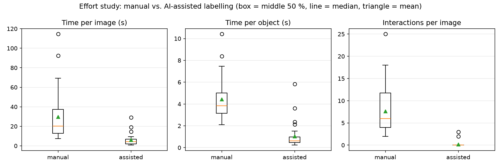

# Effort study results

Finished images: manual 30/30, assisted 30/30.

| Metric | Manual | Assisted | Reduction | p (Mann-Whitney) | Effect size r |
|---|---|---|---|---|---|
| Time per image (s) | 29.71 ± 25.81 (median 20.09) | 5.84 ± 5.97 (median 4.37) | 80.4 % | 0.0000 | 0.882 |
| Time per object (s) | 4.42 ± 1.93 (median 3.84) | 1.03 ± 1.15 (median 0.61) | 76.8 % | 0.0000 | 0.907 |
| Interactions per image | 7.6 ± 5.3 (median 6.0) | 0.17 ± 0.65 (median 0.0) | 97.8 % | 0.0000 | 0.99 |

| Label quality vs. ground truth (IoU >= 0.5) | Manual | Assisted |
|---|---|---|
| Precision | 0.7079 | 0.9062 |
| Recall | 0.6848 | 0.9508 |
| F1 | 0.6961 | 0.928 |
| Recall at lenient IoU >= 0.3 | 0.8804 | 0.9508 |
| Recall on small objects (< 32x32 px) | 0.5 | 0.9157 |
| Objects: good / loose / no label | 126 / 45 / 13 | 175 / 1 / 7 |

Final assisted labels by source: {'ai': 190, 'manual': 2, 'ai_edited': 0}

